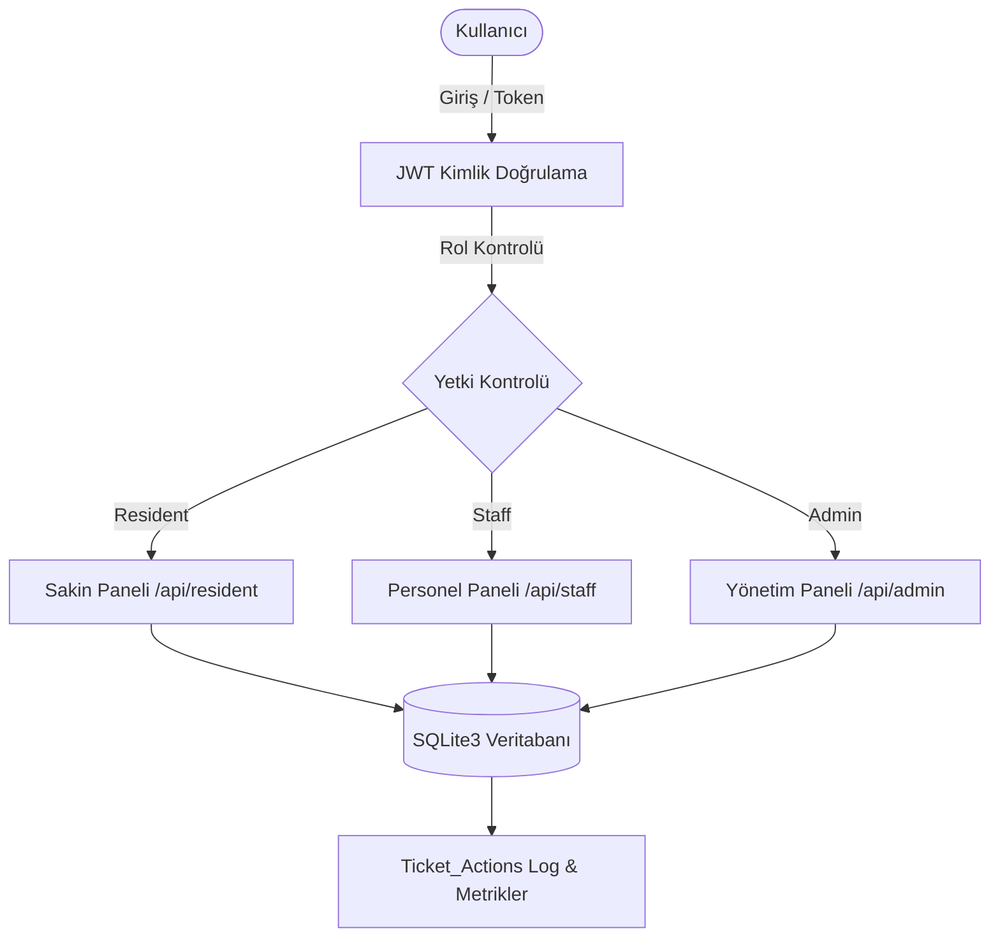

# 🏢 Apartman ve Site Yönetim Sistemi (SIYOS)

[](https://nodejs.org/)
[](https://expressjs.com/)
[](https://www.sqlite.org/)
[](https://www.docker.com/)
[](SECURITY.md)
[](LICENSE)

Modern, güvenli, rol tabanlı ve hafif bir apartman ve site yönetim web uygulaması. Bina sakinlerinin teknik ve idari taleplerini iletebildiği, site personelinin bu talepleri SLA süreleri doğrultusunda çözüme ulaştırdığı, yöneticilerin ise KPI metrikleri, blok bazlı sorun ısı haritası ve personel performans analizleriyle tüm süreci canlı izleyebildiği bütünleşik bir yönetim platformudur.

---

## 📌 İçindekiler

- [Öne Çıkan Özellikler](#-öne-çıkan-özellikler)
- [Mimari ve Rol Modeli](#-mimari-ve-rol-modeli)
- [Teknoloji Yığını](#-teknoloji-yığını)
- [Hızlı Başlangıç ve Kurulum](#-hızlı-başlangıç-ve-kurulum)
  - [Yerel Ortamda Kurulum](#1-yerel-ortamda-kurulum)
  - [Docker ve Docker Compose ile Çalıştırma](#2-docker-ve-docker-compose-ile-çalıştırma)
- [Ortam Değişkenleri (.env)](#-ortam-değişkenleri-env)
- [Varsayılan Test Hesapları](#-varsayılan-test-hesapları)
- [API Dokümantasyonu](#-api-dokümantasyonu)
- [Güvenlik ve Sertleştirme](#-güvenlik-ve-sertleştirme)
- [Katkıda Bulunma](#-katkıda-bulunma)
- [Lisans](#-lisans)

---

## 🚀 Öne Çıkan Özellikler

### 👤 1. Bina Sakinleri (Residents)
- **Hızlı ve Detaylı Talep Oluşturma:** Kategori bazlı (Tesisat, Elektrik, Temizlik, Güvenlik, Genel), öncelik dereceli ve dosya/görsel eki destekli arıza bildirimi.
- **Canlı Süreç Takibi:** Taleplerin durumunu (`Yeni`, `Atandı`, `İşlemde`, `Beklemede`, `Çözüldü`, `Kapandı`) anlık izleme.
- **Apartman Genel Sorunları:** Blok veya apartman genelinde açılmış diğer açık talepleri görerek mükerrer bildirimlerin önüne geçme.
- **Hizmet Memnuniyet Puanlaması:** Çözümlenen talepler için 1-5 yıldız arası memnuniyet puanı verme.

### 🛠️ 2. Site Personeli (Staff)
- **Görev Panosu:** Personele atanan aktif görevlerin öncelik ve tarih sırasına göre listelenmesi.
- **İşlem Yönetimi:** Tek tıklamayla "İşe Başla", "Tamamlandı" veya "Beklemeye Al" aksiyonları.
- **Çözüm Notları:** Yapılan müdahaleleri açıklayan operasyonel notlar bırakabilme.

### 📊 3. Site Yöneticisi (Admin)
- **Canlı KPI Dashboard:** Açık talep sayısı, ortalama çözüm süresi (saat), 7 günlük yeni talep eğilimi ve kritik öncelikli talepler.
- **Kategori Dağılımı ve Blok Isı Haritası:** Hangi blokta ve hangi kategoride arızaların yoğunlaştığını gösteren görsel analiz.
- **Personel Performansı:** Personel bazında ortalama çözüm süresi ve tamamlanan toplam talep istatistikleri.
- **Talep Atama & Durum Kontrolü:** Talepleri ilgili personele yönlendirme ve SLA kontrolü.
- **Kategori & SLA Yönetimi:** Yeni arıza kategorileri ve SLA saat hedefleri belirleme.
- **Kullanıcı ve Daire Dökümü:** Daire sakinleri, mülkiyet tipi (Ev Sahibi / Kiracı) ve personel listesi.

---

## 🏗️ Mimari ve Rol Modeli



### Rol Yetki Matrisi

| Eylem / Yetki | Resident | Staff | Admin |
| :--- | :---: | :---: | :---: |
| Kendi Dairesi Adına Talep Açma | :white_check_mark: | :x: | :x: |
| Kendi Taleplerini Listeleme ve Puanlama | :white_check_mark: | :x: | :x: |
| Genel Apartman Sorunlarını Görüntüleme | :white_check_mark: | :x: | :white_check_mark: |
| Kendisine Atanan Görevleri Güncelleme | :x: | :white_check_mark: | :white_check_mark: |
| Tüm Talepleri İnceleme ve Personele Atama | :x: | :x: | :white_check_mark: |
| Yönetici Dashboard & Isı Haritası İzleme | :x: | :x: | :white_check_mark: |
| Kategori ve SLA Tanımlama | :x: | :x: | :white_check_mark: |
| Kullanıcı Listesini Görüntüleme | :x: | :x: | :white_check_mark: |

---

## 🛠️ Teknoloji Yığını

- **Backend:** Node.js (v18+), Express.js (v5.x)
- **Veritabanı:** SQLite3 (`PRAGMA foreign_keys = ON;` aktif)
- **Kimlik Doğrulama & Güvenlik:** JSON Web Tokens (`jsonwebtoken`), Parola Kriptografisi (`bcryptjs`), CORS
- **Frontend:** Vanilla ES6+ JavaScript, CSS3 Değişkenleri ile Responsive Dashboard, HTML5
- **Konteyner:** Docker, Docker Compose

---

## 📦 Hızlı Başlangıç ve Kurulum

### 1. Yerel Ortamda Kurulum

#### Ön Koşullar:
- [Node.js](https://nodejs.org/) (v18 veya üstü)
- [npm](https://www.npmjs.com/) (v9 veya üstü)

```bash
# 1. Depoyu klonlayın
git clone https://github.com/keremefeyigit/Apartman-Yonetim-Sistemi.git
cd Apartman-Yonetim-Sistemi

# 2. Bağımlılıkları yükleyin
npm install

# 3. Çevre değişkenleri şablonundan .env dosyasını oluşturun
cp .env.example .env

# 4. Uygulamayı başlatın
npm start
```
Uygulama varsayılan olarak `http://localhost:3000` adresinde çalışacaktır.

---

### 2. Docker ve Docker Compose ile Çalıştırma

Sistemde Node.js kurulu olmadan tek komutla ayağa kaldırmak için:

```bash
# Konteyneri derleyin ve arka planda çalıştırın
docker compose up -d --build

# Logları takip edin
docker compose logs -f
```

Durdurmak için:
```bash
docker compose down
```

---

## ⚙️ Ortam Değişkenleri (.env)

| Değişken | Açıklama | Varsayılan | Zorunlu mu? |
| :--- | :--- | :--- | :---: |
| `PORT` | Web sunucusunun dinleyeceği port | `3000` | Hayır |
| `JWT_SECRET` | Token imzalamada kullanılan gizli anahtar | `gizli_anahtar...` | **Evet (Üretimde)** |
| `DB_PATH` | SQLite veritabanı dosyasının yolu | `./database/database.sqlite` | Hayır |

---

## 🔑 Varsayılan Test Hesapları

Uygulama ilk başlatıldığında otomatik olarak tohumlanan (seeded) test hesapları:

| Rol | E-posta | Şifre | Açıklama |
| :--- | :--- | :--- | :--- |
| **Admin** | `admin@siyos.local` | `Admin123!` | Tüm yönetimsel yetkilere sahiptir. |
| **Staff** | `staff@siyos.local` | `Staff123!` | Arıza çözümü ve saha personeli. |
| **Resident** | `resident@siyos.local` | `Resident123!` | A Blok Daire 1 sakini. |

> [!WARNING]
> Üretim ortamına alırken varsayılan şifreleri değiştirmeyi ve `.env` içerisindeki `JWT_SECRET` değerini rastgele üretilmiş güvenli bir anahtarla güncellemeyi unutmayınız.

---

## 📡 API Dokümantasyonu

### Kimlik Doğrulama (`/api`)
| Metot | Uç Nokta | Yetki | Açıklama |
| :--- | :--- | :---: | :--- |
| `POST` | `/api/login` | Herkese Açık | E-posta ve şifre ile oturum açıp JWT token döner. |
| `POST` | `/api/register` | Herkese Açık | Yeni site sakini (`Resident`) hesabı açar. |

### Sakin İşlemleri (`/api/resident`)
| Metot | Uç Nokta | Yetki | Açıklama |
| :--- | :--- | :---: | :--- |
| `GET` | `/api/resident/tickets` | Resident | Giriş yapan sakinin kendi taleplerini getirir. |
| `POST` | `/api/resident/tickets` | Resident | Yeni teknik/idari talep kaydı oluşturur. |
| `POST` | `/api/resident/tickets/:id/rate` | Resident | Çözülen talebe 1-5 arası memnuniyet puanı verir. |
| `GET` | `/api/resident/common-issues` | Resident | Diğer sakinlerin açtığı genel bina arızalarını gösterir. |
| `GET` | `/api/resident/categories` | Resident | Aktif talep kategorilerini ve SLA sürelerini listeler. |

### Personel İşlemleri (`/api/staff`)
| Metot | Uç Nokta | Yetki | Açıklama |
| :--- | :--- | :---: | :--- |
| `GET` | `/api/staff/tickets` | Staff | Personele atanmış açık görevleri listeler. |
| `PUT` | `/api/staff/tickets/:ticketId/status` | Staff | Görev durumunu (`In_Progress`, `Pending`, `Resolved`) günceller. |
| `GET` | `/api/staff/categories` | Staff | Kategori listesini döner. |

### Yönetici İşlemleri (`/api/admin`)
| Metot | Uç Nokta | Yetki | Açıklama |
| :--- | :--- | :---: | :--- |
| `GET` | `/api/admin/dashboard` | Admin | KPI metrikleri, ısı haritası ve personel performans analizini getirir. |
| `GET` | `/api/admin/tickets` | Admin | Tüm talepleri durum filtresiyle listeler. |
| `POST` | `/api/admin/tickets/:ticketId/assign`| Admin | Talebi seçilen personele atar. |
| `PUT` | `/api/admin/tickets/:ticketId/status`| Admin | Talep durumunu doğrudan günceller veya kapatır. |
| `GET` | `/api/admin/categories` | Admin | Arıza kategorilerini listeler. |
| `POST` | `/api/admin/categories` | Admin | Yeni kategori ve SLA hedef saati tanımlar. |
| `GET` | `/api/admin/users` | Admin | Tüm kullanıcıları ve daire eşleşmelerini listeler. |

---

## 🔒 Güvenlik ve Sertleştirme

Projede yapılan güvenlik denetimleri ve alınan tedbirler [SECURITY.md](SECURITY.md) dosyasında belgelenmiştir. Başlıca güvenlik iyileştirmeleri:
- **Yetki Yükseltme Koruması:** `/api/register` ucunda dışarıdan admin/personel rolü atanması engellendi.
- **XSS Koruması:** İstemci panellerindeki tüm dinamik veriler HTML süzgecinden geçirilerek güvenli render edilmektedir.
- **Gizli Veri İzolasyonu:** `.env` ve `.sqlite` dosyaları depodan arındırıldı.
- **Veri Tutarlılığı:** SQLite yabancı anahtar (`PRAGMA foreign_keys = ON;`) doğrulaması aktif edildi.
- **Hata Sızıntısı Engelleme:** İç SQL hataları kullanıcıya gizlenip sunucu loglarına yönlendirildi.

---

## 🤝 Katkıda Bulunma

Projeye katkıda bulunmak isterseniz:
1. Depoyu fork'layın.
2. Yeni bir özellik dalı oluşturun (`git checkout -b feature/yeni-ozellik`).
3. Değişikliklerinizi commit edin (`git commit -m 'feat: yeni özellik eklendi'`).
4. Dalınıza push edin (`git push origin feature/yeni-ozellik`).
5. Bir Pull Request açın.

Detaylar için [CONTRIBUTING.md](CONTRIBUTING.md) belgesini inceleyebilirsiniz.

---

## 📜 Lisans

Bu proje [MIT Lisansı](LICENSE) altında lisanslanmıştır.
